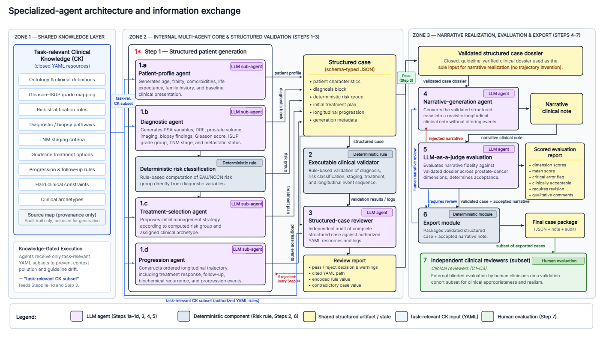

<div align="center">


# GAMA-PCa

**A Guideline-Aware Multi-Agent Framework for Synthetic Longitudinal Prostate Cancer Note Generation**

Spanish clinical narratives · Structured trajectories · Traceable validation

<p>
  <a href="#quick-start"></a>
  <a href="#generation"></a>
  <a href="#ner--regex"></a>
  <a href="LICENSE.md"></a>
</p>

<p>
  <a href="#quick-start"><strong>Quick start</strong></a> &nbsp;·&nbsp;
  <a href="#how-it-works">Architecture</a> &nbsp;·&nbsp;
  <a href="#generation">Generation</a> &nbsp;·&nbsp;
  <a href="#human-review">Human review</a> &nbsp;·&nbsp;
  <a href="#ner--regex">NER + Regex</a> &nbsp;·&nbsp;
  <a href="#citation--license">Citation</a>
</p>

</div>

---

GAMA-PCa builds fictional prostate cancer trajectories, validates their clinical consistency and turns them into longitudinal notes in Spanish. This repository includes the generation system and the existing NER+Regex pipeline—not datasets or manuscript analyses.

> [!IMPORTANT]
> **Clinical knowledge is a separate dataset.** Extract the GAMA-PCa CK dataset and point the software to it. CK is not bundled with this repository or downloaded automatically. NER runs independently of CK. The software is for research, not clinical decisions.

## At a glance

| Build | Validate | Review | Annotate |
|:---|:---|:---|:---|
| Typed patients and longitudinal trajectories | Deterministic rules and YAML-grounded review | Narrative scoring and explicit human decisions | Nine NER models plus PSA/Gleason regex |
| **GLM 5.2** | **Rules + Kimi K2.6** | **Ten clinical domains** | **BSC/PlanTL + MedSpaner** |

## Quick start

**Requirements:** Python 3.11+, Linux, and a separately installed and authenticated Ollama service. The tested Python version is 3.13. CUDA is needed **only for NER**.

### 1 · Install

```bash
python -m venv .venv
source .venv/bin/activate
python -m pip install '.[dev]'
```

### 2 · Connect your clinical knowledge

```bash
export GAMA_PCA_KNOWLEDGE_DIR=/path/to/GAMA-PCa_clinical_knowledge_dataset
export GAMA_PCA_OUTPUT_DIR=./outputs
python -m src.main --check
```

Use either the extracted dataset root or its `clinical_knowledge/` directory. The preflight checks CK and configuration without writing outputs or calling models. It does not check model availability. See the [CK dataset contract](docs/operation.md#external-clinical-knowledge).

### 3 · Generate

```bash
python -u -m src.main --n 10 --start-index 1
```

Configure the endpoint and model names in [the Ollama configuration](src/resources/configs/ollama_config.yaml). Cloud inference may incur charges.

## How it works

<a href="GAMAPC.png"></a>

<p align="center"><a href="GAMAPC.png">View full-size architecture</a> &nbsp;·&nbsp; <a href="GAMAPC.pdf">Download PDF</a></p>

The structured case fixes the clinical trajectory before narrative generation. The **structured-case reviewer** checks evidence against authorised CK; the **narrative judge** receives only the resulting note.

The **independent clinical evaluation** shown in Step 7 is a separate, non-automated study stage performed by clinical reviewers on a subset of cases. It is not executed by this software and is distinct from the operator review console described below.

| Control | Behaviour |
|:---|:---|
| **Partial repair** | Route deterministic feedback to the responsible generator, preserve valid blocks and revalidate the whole case. Ambiguous failures regenerate the case. |
| **Narrative acceptance** | Mean score **≥ 4.5/5**, with **no critical error**. |
| **`requires_revision`** | Queue human review; do not automatically reject or rewrite an otherwise accepted note. |
| **Retry limits** | Three narratives per structured candidate; ten structured attempts, with one additional full restart after repeated identical validation failures. |
| **Technical failures** | Preserve the response and checkpoint separately from clinical rejection. |

<details>
<summary><strong>Model assignments and inference settings</strong></summary>

| Role | Model | Temperature | Output tokens |
|:---|:---|---:|---:|
| Patient, diagnosis, treatment, progression | GLM 5.2 | 0.35 | 3,000 |
| Structured-case reviewer | Kimi K2.6 | 0.00 | 6,000 |
| Narrative generation | GLM 5.2 | 0.55 | 8,000 |
| Narrative judge | Kimi K2.6 | 0.00 | 6,000 |

The reviewer verifies findings against the supplied CK. Unsupported findings do not become rejection criteria. Calls use non-streaming inference with hidden reasoning disabled.

</details>

## Generation

**Resume the same batch** using the same count, ID range and plan:

```bash
python -u -m src.main --n 10 --start-index 1 --resume
```

Use `--dataset-plan` for an external plan and `--max-new-positions` to limit a session without changing quotas. The supplied plan totals 500 positions; IDs are generic, not tied to the published corpus. **Processed positions and accepted notes are counted separately.**

<details>
<summary><strong>What a run saves</strong></summary>

| Output | Content |
|:---|:---|
| `generated_json/` | Typed structured cases |
| `generated_txt/` | Accepted original narratives |
| `generated_artifacts/` | Intermediate outputs, validations and review evidence |
| `generated_prompts/`, `generated_metadata/` | Prompts and case metadata |
| `judge_reports/` | Narrative scores and flags |
| `human_review_queue/`, `technical_review_queue/` | Requests awaiting resolution |
| `rejected_cases/`, batch reports | Rejections and operational status |

Existing outputs are protected against accidental reuse. Revisions are saved separately, and process locking prevents concurrent generation writes to the same output directory.

**Keep run outputs separate from the software repository:** prompts and traces may contain CK and run-specific metadata.

</details>

## Human review

```bash
python -m src.review_console
```

| <kbd>A</kbd> | <kbd>C</kbd> | <kbd>E</kbd> | <kbd>P</kbd> | <kbd>Q</kbd> |
|:---:|:---:|:---:|:---:|:---:|
| Accept | Correct from judge comments | Write instructions | Defer | Quit |

Corrections are judged again and saved as separate versions. Acceptance requires explicit confirmation; **original narratives remain unchanged**. Select a corrected version explicitly for downstream use.

Technical and structured reviews use their own evidence and clearance rules. See [review operations](docs/operation.md#technical-and-structured-review).

## NER + Regex

Annotate notes with the existing **six BSC/PlanTL models**, **three MedSpaner models**, and **PSA/Gleason regex**, without requiring the generation CK.

Install a compatible CUDA-enabled PyTorch build, then:

```bash
python -m pip install '.[ner]'

python -m src.run_validated_silver \
  --input-dir ./outputs/generated_txt \
  --output-dir ./silver_run \
  --check

python -m src.run_validated_silver \
  --input-dir ./outputs/generated_txt \
  --output-dir ./silver_run
```

**CUDA is mandatory; output directories must be new.** Models are downloaded from their own repositories at runtime; weights are not bundled. Tests and `--check` do not download GPU models.

Read each `.ann` with its matching `.txt` in `brat/`. Offsets are zero-based Unicode positions with an exclusive end. Original bytes are retained separately; annotations are **silver-standard**.

[Model identifiers, parameters and output format →](docs/ner.md)

## Tests

```bash
python -m pytest -q -p no:cacheprovider
```

Public tests run without CK. Integration tests run only when `GAMA_PCA_KNOWLEDGE_DIR` is set; otherwise they are explicitly skipped. Tests block model-service requests.

## Citation & license

Rey-Blanes, Álvaro; Vivas-Vargas, Eloy; Veredas-Morente, Javier; Rodriguez-Castro, Manuel; Moreno-Barea, Francisco J.; and Veredas, Francisco J. (2026). *GAMA-PCa* [Software].

[Citation metadata](CITATION.cff) · [PolyForm Noncommercial 1.0.0](LICENSE.md) · [Third-party notices](THIRD_PARTY_NOTICES.md)

The software is **source-available for noncommercial use**, not open source. The separately distributed CK dataset and synthetic corpus have their own licenses. CK, model weights and third-party components are not relicensed by this software repository.

---

<div align="center">
  <strong>Structured generation. Explicit validation. Traceable narratives.</strong><br>
  <sub>GAMA-PCa · by CoLLMo</sub>
</div>
